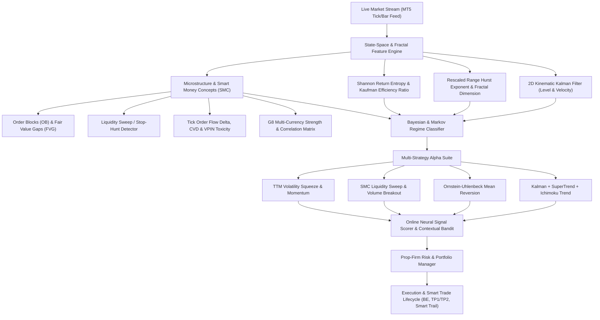

# Nolo Trading Bot v4.0 — Institutional Quantitative Architecture

## 1. System Overview

Nolo Trading Bot v4.0 combines a **Native MetaTrader 5 Expert Advisor Suite (`MQL5/` & `Testing Bot/`)** with a **Real-Time Python Quantitative & AI Engine (`nolo/`)**.

## 2. Core Quantitative Pillars

1. **State-Space Kalman Filter (`nolo/quant/kalman.py` & `MQL5/Include/Nolo/KalmanFilter.mqh`)**:
   - Models latent price level and trend velocity with dynamic innovation covariance scaling.
